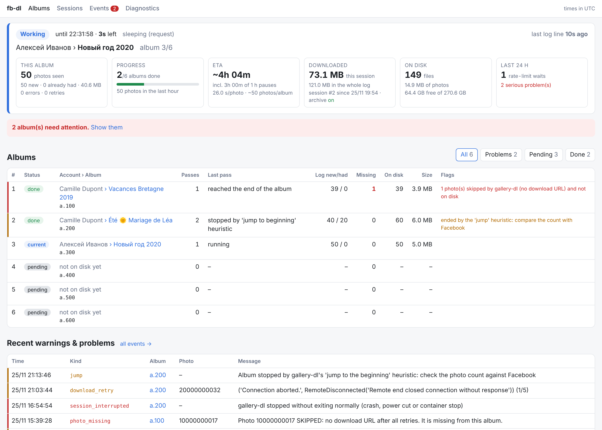

# gallery-dl dashboard

A self-hosted, read-only web dashboard to supervise a long
[gallery-dl](https://github.com/mikf/gallery-dl) download of Facebook albums:
what it is doing right now, which albums are done, and above all **what may be
missing**.


*(demo data: every name and ID is invented)*

## What it shows

- **Live header**: downloading / pause before the next album (countdown) /
  rate-limited until hh:mm / blocked / login required / **stalled** (log quiet
  longer than any scheduled pause) / finished with exit code. Current account
  and album, album n/N, new / already-had / missing photos, ETA, downloaded
  size, disk usage and free space, whether the download archive is active.
- **Albums** in `albums.txt` order, each checked for:
  - photos gallery-dl skipped with *"Failed to find photo download URL …
    Skipping."* (the album is still marked done: the most likely silent gap),
  - albums stopped by gallery-dl's *"jump to the beginning"* heuristic,
  - albums marked done whose last pass did not reach the end of the album,
  - photos downloaded per the log but missing on disk, `.part` leftovers,
    media without JSON metadata.
- **Disk check** (read-only, cached, throttled): every photo is opened and
  fully decoded (truncated/corrupt files, HTML pages saved as photos, AVIF data
  in a `.jpg`...); every album is checked for gaps with the `num` positions and
  the `next_photo_id` chain gallery-dl writes in each JSON, which gives the IDs
  of missing photos even for albums downloaded before the log started; JSON
  sidecars are checked against filenames and folders; duplicates are found by
  photo ID, by identical image data (JPEG hashed from the first scan marker, so
  EXIF rewrites do not hide them) and by visual similarity (thumbnails shown);
  the download archive is compared with the disk (an archived photo that is
  gone would never be downloaded again); and the log is compared with the
  disk: every photo gallery-dl saw must be on disk, and the last pass that
  reached the end of an album gives its full photo list (this also catches a
  photo missing at the very end of an album). An album is "verified" when
  files, JSON and log agree, "verified (disk only)" when it is not in the log.
- **Dates** (read-only): status of a `fix_order.py`-style date fix (mtime +
  EXIF/XMP/QuickTime date in album order) per album: applied / not run /
  partial (new photos) / **changed** (running it now would modify files it had
  already corrected, e.g. after the album changed or with another `--tz`),
  what a run would change, timestamp collisions inside and between albums,
  and whether the album is proven complete enough to be fixed. The ordering
  logic is a line-by-line port of the script and was checked against the real
  script's `--dry-run`.
- **Sessions** (one per gallery-dl start): result / exit code, interrupted
  runs (crash, power cut), time spent in each kind of sleep and 429 wait.
- **Events**: every warning and error, with tracebacks; **Diagnostics**: log
  lines the parser does not know yet, as privacy-safe templates.

## Privacy

- Read-only: the downloads are mounted `:ro`; nothing is sent anywhere, no
  external CDN, no telemetry.
- Signed image-server URLs (`*.fbcdn.net`, which carry tokens) are never
  stored; facebook.com links are reduced to photo and album IDs.
- Album names and photos are private: put a login in front (Caddy example
  below). The container publishes no port.

## Layout

```
app/                  the dashboard (FastAPI + Jinja, runs as an unprivileged uid)
  logparse.py         log parser: sessions -> albums -> photos, sleeps, 429s, errors
  status.py           live header (state, ETA, progress) + per-album checks
  disk.py             light read-only disk scan (names, counts, sizes, free space)
  albums.py           albums.txt reader (gallery-dl -I comments finished albums out)
  integrity.py        deep read-only disk check (decode, completeness, duplicates, archive)
  dates.py            read-only fix_order.py status (dates, order, overlaps)
Dockerfile            builds the dashboard image (only app/ goes in, see .dockerignore)
tests/                pytest suite, fake-log generator, demo builder
tools/seed_archive.py fill a gallery-dl download archive from files already on disk
deploy/               example compose.yml and gallery-dl.conf
```

Built against gallery-dl **1.32.21** with
`"output": {"logfile": {"level": "debug", "format": "[{asctime}] [{name}][{levelname}] {message}"}}`.

## gallery-dl setup notes

See `deploy/`. Three things matter:

1. **Mount the folder holding `albums.txt`, not the file.** `-I` rewrites the
   file (write + rename); a single-file bind mount keeps showing the old one.
2. **Use a download archive keyed on album + photo ID**:
   `"archive": "...sqlite3", "archive-format": "{set_id}_{id}"`.
   Facebook serves many JPEGs from `.avif` URLs; gallery-dl's "file exists"
   check uses the URL extension, misses the `.jpg` on disk and downloads the
   photo again after every interruption. `tools/seed_archive.py` fills the
   archive from existing files (dry run by default; only complete files with
   valid JSON are added).
3. **Run gallery-dl once per container start** (wrapper in `deploy/compose.yml`):
   it still restarts after a power cut, logs its exit code for the dashboard,
   and does not loop over the list forever.

## Deploy

Clone this repo **as the `web-dashboard` folder** next to your `compose.yml`
(the `webui` service has `build: ./web-dashboard`), once:

```bash
git clone https://github.com/lamarch/gallery-dl-dashboard.git web-dashboard
```

```bash
docker compose up -d --build webui
```

Update later (from the compose folder):

```bash
git -C web-dashboard pull && docker compose up -d --build webui
```

Caddy:

```
fbdl.example.com {
    basic_auth {
        someuser <hash from: caddy hash-password>
    }
    reverse_proxy fb-dl-dashboard:8000
}
```

| Variable | Default | Meaning |
|---|---|---|
| `LOG_FILE` | `/downloads/logs/fb-dl.log` | gallery-dl `output.logfile.path` |
| `ALBUMS_FILE` | `/input/albums.txt` | the `-I` file (mount its folder) |
| `DOWNLOADS_ROOT` | `/downloads/facebook` | folder holding the account folders |
| `DISPLAY_TZ` | `TZ`, then UTC | timezone used to display times |
| `LOG_TZ` | `UTC` | timezone of the log timestamps (gallery-dl container time) |
| `BASE_PATH` | empty | e.g. `/fbdl` when served under a sub-path |
| `POLL_SECONDS` / `DISK_SCAN_SECONDS` | 2 / 60 | log polling / disk scan intervals |
| `DATA_DIR` | `/data` | writable folder for the disk-check cache (`integrity.sqlite3`) |
| `ARCHIVE_FILE` | `/downloads/logs/fb-archive.sqlite3` | gallery-dl download archive (read-only) |
| `INTEGRITY` | `1` | `0` turns the disk check off |
| `INTEGRITY_MAX_MBPS` | `40` | disk read cap for the check, in MB/s |
| `INTEGRITY_RESCAN_SECONDS` | `900` | pause between passes (only changed files are re-read) |
| `FIXORDER_TZ` | `DISPLAY_TZ` | the `--tz` you run fix_order.py with (a different one rewrites every EXIF) |
| `FIXORDER_STEP` | `1` | the `--step` you run fix_order.py with |

## Development

```bash
pip install pytest fastapi uvicorn jinja2
python3 -m pytest -q tests tools/tests
# archive tests against gallery-dl's own code:
GALLERY_DL_SRC=/path/to/gallery-dl-checkout python3 -m pytest -q tools/tests
# demo environment + local server:
python3 tests/make_demo.py /tmp/demo
LOG_FILE=/tmp/demo/logs/fb-dl.log ALBUMS_FILE=/tmp/demo/input/albums.txt \
  DOWNLOADS_ROOT=/tmp/demo/facebook DISK_PATH=/tmp/demo uvicorn app.main:app --port 8000
```
